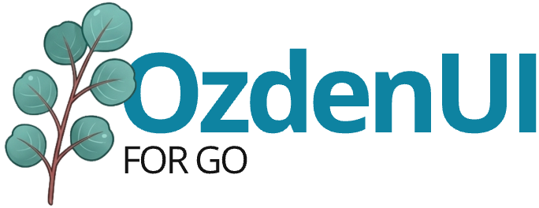
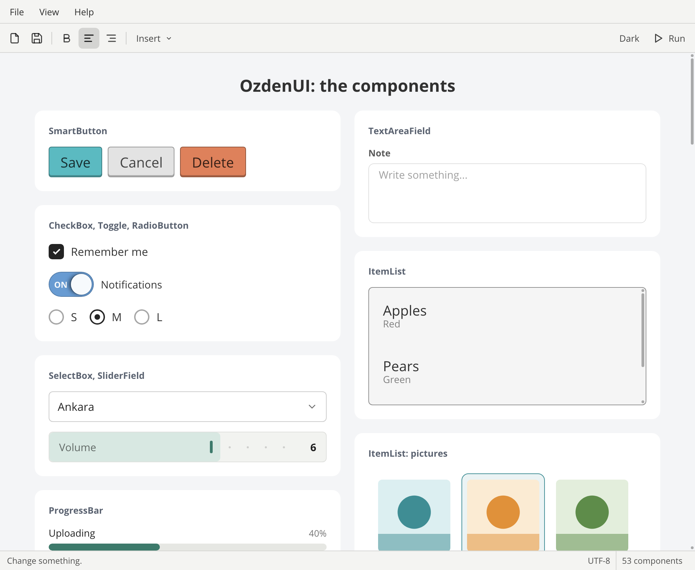

<p align="center">
  <picture>
    <source media="(prefers-color-scheme: dark)" srcset="images/logo-dark.png">
    
  </picture>
</p>

# OzdenUI for Go

A small, modern window of its own in Go, made of [basic.js](https://bug7a.github.io/basic.js/) objects and the
components of the OzdenUI kit. Only Go: no JavaScript, no HTML, no CSS, no build step of a front end. Your Go code
makes the objects, and a window shows them. The built program is one file.

The site: https://bug7a.github.io/ozdenui-go/ and the handbook, ten short chapters with programs that run:
[English](https://bug7a.github.io/ozdenui-go/handbook/) ([Markdown](handbook/README.md)),
[Türkçe](https://bug7a.github.io/ozdenui-go/handbook/?lang=tr) ([Markdown](handbook/turkce/README.md)).

<p align="center">
  
</p>

The window above is [examples/gallery](examples/gallery/main.go), the main components of the kit in one window.

## Why OzdenUI

Made for a small tool, a command line program that needs a window, and a tool given to a team as one file.

- **Only Go.** The window is made of Go values: no HTML, CSS or JavaScript to write, no Node or npm, no build step of
  a front end.
- **One file to give away.** `go build` makes one program (about 15 MB) with the page, basic.js and the components
  inside it: nothing else to install. Its window is the web view of the system: WKWebView, WebView2, WebKitGTK.
- **A modern look from the first line.** 83 components of the [OzdenUI kit](https://bug7a.github.io/js-components/),
  each with its own Go type: buttons, fields, lists, a table of 100000 rows, charts, a date picker, a chat, a JSON
  editor, a canvas. A dark window is one word: `ui.Window{Theme: "dark"}`.
- **Typed params.** Every component has its Props struct: the editor offers the names, the compiler catches a
  misspelled one.
- **Code that reads like the window.** A group takes a function that makes its objects, so the shape of the code is
  the shape of the window. Your program runs on one goroutine, one task at a time: no locks.
- **Easy to learn, with an AI assistant too.** A handbook of ten short chapters in English and Turkish, every program
  in it built by the tests. One command teaches your assistant the module, and `OZDENUI_LOOK=app.png go run .` lets
  it see the window it made.
- **Tested on three systems.** At every push the tests run and every example is drawn on Windows, macOS and Linux.
  Open source, Apache 2.0.

```go
package main

import (
	"strconv"

	ui "github.com/bug7a/ozdenui-go"
)

var (
	count = 0
	label *ui.Object
)

func main() {
	ui.Run(start, ui.Window{Title: "Counter", Width: 360, Height: 260})
}

func start(page *ui.Object) {
	page.Set("color", "#F4F5F7")
	ui.VGroup(ui.Props{Gap: 16}, func() {
		label = ui.Label(ui.Props{Text: "0", FontSize: 48})
		ui.HGroup(ui.Props{Hug: true, Gap: 10}, func() {
			ui.SmartButton(ui.SmartButtonProps{LabelText: "Minus", OnClick: func() { add(-1) }})
			ui.SmartButton(ui.SmartButtonProps{LabelText: "Plus", Tone: "cyan", OnClick: func() { add(1) }})
		})
	})
}

func add(step int) {
	count += step
	label.SetText(strconv.Itoa(count))
}
```

```
go get github.com/bug7a/ozdenui-go
```

v0.2, experimental: tested on macOS, Windows 11 and Linux (Ubuntu 24.04). Go 1.22 or newer.

- **macOS:** the window is the web view of the system (WKWebView), inside the program. It needs cgo: the command line
  tools of Xcode (`xcode-select --install`). The first build takes about ten seconds and may print warnings of the web
  view's C code; the next ones are fast.
- **Windows:** the window is the web view of the system (WebView2, in every Windows 11 and in most Windows 10), inside
  the program. No C compiler is needed. A computer without WebView2 gets the app window of Edge or Chrome.
- **Linux:** the window is the web view of the system (WebKitGTK), inside the program. No C compiler is needed: its
  library is loaded when the program runs. Most desktops have it; if not: `sudo apt install libwebkit2gtk-4.1-0`
  (Debian, Ubuntu). Without it the window is an app window of Chrome, Chromium or Edge.

**With an AI assistant** (Claude Code, Codex, Cursor, Copilot...): OzdenUI is new, so an assistant does not know it
yet. One command writes its rules (how a program is made, the layout, the events, the components, the mistakes to
avoid) into the folder of your project, where the assistant reads them by itself:

```
go run github.com/bug7a/ozdenui-go/cmd/ozdenui@latest agents              # into AGENTS.md
go run github.com/bug7a/ozdenui-go/cmd/ozdenui@latest agents CLAUDE.md    # into another file
```

And the assistant can look at the window it made, without a window:

```
OZDENUI_LOOK=app.png go run .       # runs the program as it is, saves a picture of its window, ends
```

## How it works

- The window shows a page of basic.js that is inside the program (`go:embed`), served only to this computer.
- An object in Go is a proxy: it keeps an id and the values it was given, and sends commands to the page, where the
  real basic.js object lives. The events of the page come back as calls of your functions.
- Everything of your program runs on one goroutine, one task at a time (`start`, an event, a timer): no locks. The
  commands of a task go to the page together, when the task ends.
- Reading a value the program gave, or the state a component tells (the text of a field, a checked box), asks nothing
  of the page.

## Objects

Five plain objects and two groups, all with `ui.Props`:

```go
ui.Box(ui.Props{Left: 20, Top: 20, Width: 200, Height: 120, Color: "white", Round: 8}, func() {
	ui.Label(ui.Props{Left: 12, Top: 12, Text: "In the box"})       // a place of its own in a Box
})
ui.VGroup(ui.Props{Gap: 12, Padding: 20, Align: "left top"}, func() { // one under the other
	ui.Label(ui.Props{Text: "A name", FontSize: 15})
	ui.Input(ui.Props{Width: 220, Placeholder: "Type here", OnEnter: save})
	ui.Button(ui.Props{Text: "Save", OnClick: save})
	ui.Icon(ui.Props{Width: 48, Height: 48, Picture: "photo.png"})
})
```

- A field that is not written keeps the default of basic.js; a zero that is written is a value (`Gap: 0`).
- A size is a number (px) or a text (`"100%"`, `"auto"`). `Text` is shown as it is written; `Html` takes HTML.
- A group is 100% x 100%; `Hug: true` wraps its objects, `Fill: true` takes the room the others leave.
- Later: `obj.Set("text", "Hi", "fontSize", 20)` (the names of basic.js), `obj.SetText()`, `obj.Text()`, `obj.Hide()`,
  `obj.Show()`, `obj.Remove()`, `box.Add(func() { ... })` to make more objects in a box.
- Events: `OnClick`, `OnInput`, `OnEnter`, `OnKeyDown`..., or `obj.On("dblclick", fn)`; a handler is `func()`,
  `func(obj *ui.Object)` or `func(obj *ui.Object, event ui.Event)`.

## Components

Every component of the kit is a function with its own `...Props` type; its fields are the params of the kit, each
with its default in its comment (`go doc github.com/bug7a/ozdenui-go SelectBoxProps`), so an editor offers them and a
wrong name does not compile.

```go
name := ui.TextField(ui.TextFieldProps{TitleText: "Name", Width: 260, OnEnter: save})
color := ui.SelectBox(ui.SelectBoxProps{Options: []string{"Red", "Green", "Blue"}, Value: "Green"})
agree := ui.CheckBox(ui.CheckBoxProps{LabelText: "I agree", OnChange: func(box *ui.Object) {
	fmt.Println(box.Checked())
}})
ui.SmartButton(ui.SmartButtonProps{LabelText: "Save", Tone: "cyan", OnClick: func() {
	fmt.Println(name.Text(), color.Value(), agree.Checked())  // read without a question to the page
}})
```

| For | Functions |
|---|---|
| Buttons | `SmartButton`, `ActionButton`, `HoldToConfirmButton` |
| Fields | `TextField`, `EmailField`, `PasswordField`, `NumberField`, `CurrencyField`, `PhoneField`, `UrlField`, `TextAreaField`, `SearchInput`, `TagInput` |
| Choices | `CheckBox`, `Toggle`, `RadioButton`, `SelectBox`, `TinySelect`, `Slider`, `SliderField`, `RangeSlider`, `Stepper`, `DatePicker`, `TimePicker`, `ColorPicker` |
| Lists and tables | `ItemList`, `SortableList`, `TreeView`, `SmartTable`, `DataTable`, `TinyTable` |
| Areas that hold objects | `ScrollArea`, `GridGroup`, `Tabs`, `Accordion`, `Splitter`, `SidePanel` |
| Bars | `MenuBar`, `ToolBar`, `StatusBar`, `ContextMenu`, `AppBar`, `BottomBar`, `Breadcrumbs` |
| Messages | `Tooltip`, `LoadingScreen`, `ProgressBar`, `LineProgressBar`, `StepBar`, `Notice`, `Badge` |
| Views | `GraphBox`, `MiniGraphBox`, `SparkLineBox`, `Gauge`, `LogView`, `ImageView`, `MarkdownView`, `JsonView`, `JsonEditor`, `CodeEditor`, `RichTextEditor`, `Canvas`, `ChatView`, `WebView`, `FilePicker`, `TimeLine` |

- A callback gets the object and the values the kit names in the comment of the field, each in the type your
  function asks for: `OnSelect: func(table *ui.Object, row Person)`.
- A row of a table and an item of a list may be a struct of your program (its `json` tags are its keys) or a
  `ui.P{"key": "tr", "text": "Türkiye"}` (`ui.P` is `map[string]any`).
- The areas: `ui.ScrollArea(props, func() { ... })`, `tabs.Panel(key, func() { ... })`,
  `accordion.Section(key, func() { ... })`, `splitter.First(...)` / `splitter.Second(...)`, `panel.Body(...)`.
- Later: `obj.Set("unitText", "kg")` changes a param (with the method of the kit when it has one; the callback of the
  component is not called by a change of the code), `obj.Call("addItem", item)` calls a method of the kit,
  `obj.Ask("getSelectedKeys")` returns its result.
- A component is loaded into the page when the program first names it, with what it needs: a program pays only for
  what it uses.
- Any component by its name, with its params by their names in the kit: `ui.Component("Gauge", ui.P{"value": 72})`.

## Dialogs and messages

```go
if ui.Confirm("Delete the list?", ui.DialogOptions{Danger: true}) { ... }   // waits; the window keeps working
name, ok := ui.Prompt("The name of the list:")
ui.Alert("Saved.")
switch ui.Ask("Save the changes?", "Save", "Don't save", "Cancel") { ... }
ui.ToastSuccess("Saved.")                                                    // never waits
path := ui.OpenFile(ui.FileOptions{Types: []string{"csv"}})                  // the file dialog of the system
```

## Time and goroutines

```go
stop := ui.Every(1000, tick)        // again and again; stop() ends it
ui.After(3000, ui.Close)            // once

go func() {                         // a slow job: the window does not wait for it
	text := download()
	ui.Do(func() { label.SetText(text) })   // the objects are changed on the goroutine of the window
}()
```

An object changed from another goroutine panics with this fix in its message; nothing breaks without a word.

## Light, dark, minimal

```go
ui.Run(start, ui.Window{Theme: "dark"})                                  // "light", "dark", "auto"
ui.Run(start, ui.Window{Style: "minimal", Accent: "#2A78D6"})            // small, made of lines, one color
```

`ui.Window{Language: "tr"}` is the language of the texts of the window (capital letters, word breaks).

In a dark window every component takes its dark look by itself, and the plain objects and the page are dark too.
`ui.SetTheme("dark")` changes it while the program runs (`start()` runs again). One component:
`StyleName: "..."` (the doc of its function names its packages) or `Style: ui.P{"box": ui.P{"round": 12}}`.

## Examples

`go run ./examples/gallery` (from a clone of the repository):

| | |
|---|---|
| `counter`, `greeting`, `basics` | the first steps |
| `notes`, `todo`, `form`, `settings`, `calculator` | small programs |
| `dialogs`, `charts`, `clock`, `game` | dialogs, charts, timers, a Box with places and keys |
| `csv-viewer`, `json-viewer`, `image-viewer`, `editor`, `markdown-editor` | files of the computer |
| `job-log` | a goroutine that tells its progress |
| `chat`, `gallery`, `minimal-theme` | the bigger ones |

## Limits of v0.2

- macOS, Windows and Linux are tested (Linux: Ubuntu 24.04, with WebKitGTK and with Chromium). A Linux computer
  without WebKitGTK opens the app window of Chrome, Chromium or Edge (with none of them: a tab of the default browser).
  The older way to WebKitGTK, with cgo (`-tags ozdenui_webview`, webkit2gtk-4.0), is still there for Ubuntu 22.04.
- Windows: the window is sharp on the scale of the main screen; on a second screen with another scale it is
  stretched by the system.
- One window for a program.
- A callback of the kit that must answer at once (a validator, `createItemView`) can not be a Go function: the answer
  of the program comes after the page has drawn.
- A file dropped on a `FilePicker` gives its name, not its path on the computer; a click on it opens the file dialog
  of the system, and those files have their paths (`picker.Paths()`).
- No hot reload: `go run .` again.

## Development

```
go test ./...                    # the checks; TestWindow plays a real page in a hidden Chrome
checks/look-all.sh               # a picture of every example, light and dark (pictures/)
checks/handbook.sh               # every whole program of the handbook, built and drawn (pictures/handbook/)
./update-web.sh --commit HEAD    # the kit copy (web/) from the js-components repository, then kit_gen.go
go run ./internal/gen            # kit_gen.go again, after a change of internal/gen/spec.json
```

`kit_gen.go` (the Props types and the table of the components) is written by `internal/gen` from the files of the
kit in `web/comp` and from `internal/gen/spec.json`; never edit it by hand, and never edit the copy in `web/basic`
and `web/comp`.

The family: [OzdenUI for Python](https://github.com/bug7a/ozdenui-python) is the same kit for Python;
[basic.js](https://bug7a.github.io/basic.js/) and the [components](https://bug7a.github.io/js-components/) are the
JavaScript they stand on.

## License

Apache 2.0. Copyright 2026 Buğra Özden. basic.js and the components of the kit are in `web/` (Apache 2.0, the same
author); the window of macOS is [webview](https://github.com/webview/webview_go) (MIT), the window of Windows is
[go-webview2](https://github.com/jchv/go-webview2) (MIT).

Developed with the help of Claude Code (Anthropic).
